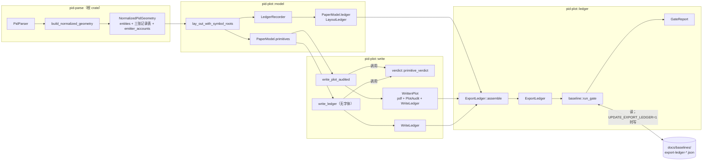
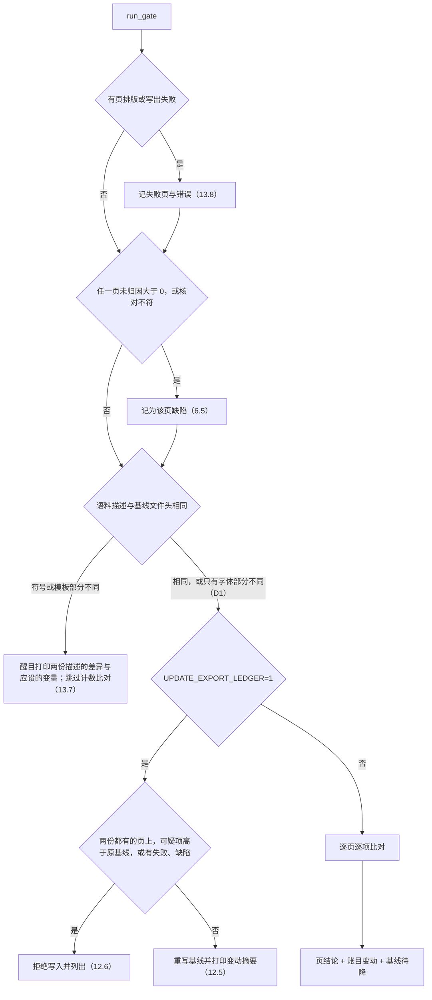

# Design Document

出图记账（pdf-export-ledger）设计文档。结构标题沿用规格模板的英文，正文用中文；代码标识符、路径、类型名保持英文。代码位置按 2026-11-04 磁盘上的工作树核对，行号写作「约 N 行」：他人的并发改动会让行号漂移，以函数名为准。

## Overview

出图记账给每一页记一本账（Export_Ledger）：页上的每条图形记录、每个实体、每个页面图元、每一段笔画，要么上页，要么落到附录 A 的一个原因码，差额单列为未归因。账本只观测，写出的 PDF 字节与 `PaperModel` 已有字段都不变。

### 设计要点

1. **账分三段产出，每段搭在已有的一次调用上。**
   - 解析层与排版层：`lay_out_with_symbol_roots` 里的记账器 `LedgerRecorder` 把账写进 `PaperModel` 的新字段 `ledger: LayoutLedger`（需求 11.1、14.1）。
   - 写出层：不读字体的纯判定函数 `write::verdict::primitive_verdict` 判每个页面图元的结局。`write_plot_audited` 调它，并改为返回 `WrittenPlot { pdf, audit, ledger }`（需求 11.2、14.2）；无字体入口 `write::write_ledger(&PaperModel)` 也调它（需求 5.5）。
   - 汇总：`ExportLedger::assemble(&PaperModel, &WriteLedger)` 定实体结局（端到端，附录 B.1）、算各层差额、与代码里已有的计数核对。
2. **判定只有一份。** `paint_primitive`、`stroke_runs`、`show_text` 里的丢弃判据挪进 `pid-plot/src/write/verdict.rs`，写出器改为调用它们，判据与判断顺序都不变。写出器另外记下每个图元实际写出的 `S`、`f`、`BT … ET` 与 `l` 的个数，与判定逐图元核对（需求 5.6）。
3. **新代码放进新文件。** `pid-plot/src/ledger.rs` 及其子模块、`pid-plot/src/write/verdict.rs`、一个新测试文件、一个探针。`model.rs` 与 `write.rs` 只动挂钩点：私有函数的返回值、几处计数调用、一处 `retain`、`write_plot_audited` 的返回类型。
4. **两道门禁，两种语料。** 夹具门禁用 `lay_out_with_symbol_roots` 显式给出只含已入库文件的仓库语料，不读字体，CI 与本机读到同一份账。备份门禁挂在 `export_plant_backup` 已有的写出循环上，复用本次运行产出的 `PaperModel` 与写出结果（需求 11.3）。
5. **根 crate 只加发射器账。** `NormalizedPidGeometry` 新增 `emitter_accounts`，按（Sheet 流，记录族）记已解码数、发射的实体数与两类跳过数，供附录 A.1 末三行与族级守恒（需求 3.4–3.6）使用。
6. **字节对照用探针。** `pid-plot/examples/probe_export_bytes_unchanged.rs` 在改库代码之前、同一工作树上记下 53 + 7 + 11 页的 PDF 与 `PaperModel` 的 SHA-256，实施后重算比对（需求 9.1–9.3）。

### 读码结论

下列事实决定了上面的取舍，均已在当前磁盘内容上核对。

- **仓库语料取不干净。** `lay_out_drawing`（`pid-plot/src/model.rs` 约 931 行）经 `symbol_library()`（约 1456 行）找符号库：设了 `PID_SYMBOL_LIBRARY` 就整体替换搜索路径；否则只要目录存在，就追加被 gitignore 的 `test-file/symbols-full`，而 CI 上没有这个目录。夹具门禁因此改用 `lay_out_with_symbol_roots`，符号来源显式给 `test-file/symbols` 与 `test-file/backup-test/{DWG-0202GP06-01_p,TEST02_p}/RefData~*.zip`。
- **模板来源由语料目录决定。** `border_template_sources(corpus, package)`（约 1609 行）查 `corpus/Ref/Template Files`、`corpus/Ref`、上一级的同名目录、`corpus` 与上一级的 `RefData~*.zip`，以及 `drawing_package_dir`（约 1797 行）找到的 `<图名>_p` 包。取 `corpus = test-file` 时命中入库的 4 个 `.igr`；两张 DWG-0202 图另经包目录找到 `test-file/backup-test/DWG-0202GP06-01_p` 的包内模板。`test-file/*.zip` 被 gitignore，本机若在那里放了 `RefData~*.zip` 会改变模板候选，这种差异由语料描述抓出（需求 13.7）。
- **写出器的丢弃判据都不依赖字体。** `show_text`（`pid-plot/src/write.rs` 约 955 行）在约 962、966、979 行的三处早退只看文本、原点、旋转与高度；`paint_primitive`（约 573 行）与 `stroke_runs`（约 702 行）只看几何与笔宽。要量字宽的只有压缩与尾部裁切，即 `PlotAudit` 的两个计数。`write_plot_audited`（约 241 行）在页面有可写文字而没给字体时报错，CI 上没有字体。
- **`PlotAudit` 是 `Copy`**（约 203 行），放不下表。`write_plot_audited` 只有三个调用方：`write_plot`（约 197 行）、`pid-plot/tests/export_plant_backup.rs` 约 1330 行、`pid-plot/src/bin/pid_plot.rs` 约 59 行。
- **`PaperModel` 不能 `Default`。** 生产代码只有一处构造（`model.rs` 约 1124 行）；测试里有 20 处字面量：`write.rs` 14 处、`model.rs` 4 处、`witness.rs` 与 `fonts.rs` 各 1 处。没有测试比较两个完整的 `PaperModel`。
- **私有排版函数被现有单测直接调用**，包括 `push_entity`、`push_symbol_primitive`、`label_line_ranges`、`load_border_template`。挂钩点改返回值时用自定义类型，不用 `Result`，以免 `unused_must_use` 在 `RUSTFLAGS=-Dwarnings` 下把现有的语句式调用变成错误；参数要变的函数另加带计数的变体，原函数委托过去。
- **发射器一条记录一个实体。** `EMITTERS`（`src/geometry.rs` 约 2226 行）里每个发射族只在 `source_range(..)` 为 `None` 时跳过一条记录，另有三处按形状跳过：`igLineString2d`（约 2731、2746 行）、`igBoundary2d`（约 3005 行）、`igBspCurve2d`（约 3139 行）。每族的已解码数由公开注册表 `SHEET_RECORD_FAMILIES` 的 `record_count` 给出（`src/model/sheet_families.rs`）。金样 `tests/geometry_golden_snapshot.rs` 只序列化 `entities`。
- **`point_marker_degenerate` 按原文不可达。** `PointMarker::draws()` 的定义是「至少一笔不退化」（`src/style_link.rs` 约 973、1024 行），`push_entity_with` 的 Point 臂（`model.rs` 约 2309 行）先判 `draws()`，所以「笔画全部退化」总是先落进 `point_no_marker`。见需求偏差 D2。
- **CI 上有能用的测试字体。** `write.rs` 的单测用 `pdfcraft_fonts::INTER_REGULAR` 作兜底字型（`key` 为空字符串），CI 上能真实写出 PDF。判定与写出一致性的性质测试用它。
- **有并发改动。** `git status` 显示 `pid-plot/src/{model,write,compare,fonts,witness}.rs`、`pid-plot/tests/reference_plots_acceptance.rs`、若干探针与 `docs/analysis` 有他人尚未提交的修改。
- **默认运行与基线语料不同。** `export_plant_backup` 不设变量时用共享语料 `D:\work\cad\PID自研软件验证`，模板来自它的 `Ref/Template Files`；附录 B.5 的基线在备份包语料 `D:\work\cad\pid-test-data` 下取，模板来自包内 `RefData~4~682.zip`。两者的语料描述不同，默认运行会跳过 53 页的计数比对。53 张图本身在 `D:\work\plant-code\cad\pid-test-data\backup-plant-data`，由 `backup_dir()` 的查找顺序找到。

## 需求偏差（Requirement Deviations）

### 已确认

用户于 2026-11-04 确认 D1、D2 都按推荐处理；下文的「推荐」即实施口径，备选只作记录。

**D1 语料描述里的字体部分（术语表 Corpus_Descriptor、需求 13.7）。** 术语表的语料描述含「字体来源」，需求 13.7 规定描述不同就跳过计数比对。本设计里只有两个部分上页标记依赖字体（附录 A.6 的 `text_condensed`、`text_clipped_at_floor`），其余结局与计数都由无字体的判定给出。照原文，换一套字体文件就会跳过 53 页的全部计数比对，而这时能变的只有这两个标记。

- 推荐：描述保留字体部分，记嵌入字型的键名（`PreparedFont::key`，如 `FangSong`、`SimSun`），不记目录。符号或模板部分不同 → 跳过全部计数比对；只有字体部分不同 → 只跳过这两个字体标记的比对，其余照比。这缩小了 13.7 的跳过范围，所以列为偏差。键名不是文件名：`fonts.rs` 的 `PreparedFont` 不带文件名，加字段要改动正被他人修改的 `fonts.rs` 和 `bin/pid_plot.rs` 里的构造；键名决定写出时用哪套字型，足以说明字体部分。
- 备选 A：从描述里去掉字体，两个字体标记照常比对；字体不同时这两个标记的差异会使门禁失败。
- 备选 B：按原文，字体部分不同也跳过全部计数比对。

**D2 `point_marker_degenerate` 不可达（附录 A.2、需求 1.4、2.4）。** 附录 A.2 把「`marker.draws()` 为假」列在 `point_no_marker` 下，又把「marker 的笔画全部退化」列为 `point_marker_degenerate`。`draws()` 为假恰好等于「笔画全部退化或没有笔画」，按需求 1.4「取第一个命中」，后者永远轮不到，需求 2.4 要的单测也写不出来。

- 推荐：按 marker 是否存在来分。解析不到线型、或线型没有 marker → `point_no_marker`（有意）；有 marker 但 `draws()` 为假 → `point_marker_degenerate`（可疑）。画法不变，只改归类，两个码都可达、可测。
- 备选：按原文保留。`point_marker_degenerate` 在 rustdoc 里注明「构造上不可达，应为 0」，它的单测改为断言这种输入落在 `point_no_marker`。

### 按此解读，不改需求

- **I1 无字体账本里的两个字体标记（需求 5.4、8.6、1.7）。** 夹具基线在 CI 上不读字体取得，`text_condensed` 与 `text_clipped_at_floor` 量不出来，在无字体账本里记为未测：JSON 里不出现这两个键，页上 `fonts_measured` 为 `false`。需求 8.6 的核对只在有字体的写出上做；无字体账本的部分上页计数不含这两种标记。
- **I2 实体的部分上页（需求 1.7）。** 实体级 Partially_On_Page 取：实体已上页，且它的页面图元里至少一个带附录 A.6 的标记，或至少一个没有上页（含被 `off_sheet` 移除的）。
- **I3 成员为空的 `Boundary`（附录 A.3 的缺口）。** 体图元是成员为空的 `Boundary` 时，`push_symbol_primitive` 什么也不产出，附录 A.3 没有对应的原因码。设计不新增原因码：这种体图元记为体层未归因，门禁随之失败；若首次取基线时出现，需要先补需求。成员级的退化（一个 `Boundary` 里部分圆退化、其余照画）不单独计，粒度按需求 4.3 停在体图元。
- **I4 段的总数与已写数不进比对（需求 12.2、13.4–13.6）。** 弧与圆展平成多少段取决于 `kurbo` 的浮点运算，Windows 与 Linux 的 libm 结果可能差一个末位，CI 上比夹具基线会误报。13.4–13.6 要比的是丢弃计数、上页计数与交叉计数，不含段总数与已写数。这两个数照写进基线供人读，段层守恒照查，但不参与比对；段的各丢弃原因计数照常比对。
- **I5 需求 8.5 的复核位置。** 排版段把三张表逐项抄进账本，相等由构造保证。夹具门禁再解析一次每页、逐项比对；备份门禁不复算，以免 53 页多解析一遍（需求 11.4）。
- **I6 描述不同时的重写与措辞（需求 12.6、13.7、15.1）。** 语料描述的符号或模板部分与基线文件头不同时，`UPDATE_EXPORT_LEDGER=1` 也拒绝重写，并提示：若是有意换语料，先删除基线文件再重写。这时计数没有比，逐页不给「未发现可归属缺陷」，只列出未归因大于 0 的页。只有字体部分不同时（D1 推荐口径）允许重写，变动摘要里列出字体部分的变化。
- **I7 `0x0010` 的两个族视图。** `SubRecord0x0010` 与 `AttributeFragment` 是同一信封的两个注册视图，`record_audit_only_family` 按族各记一次；两族相加不是记录数。

## Architecture



一页的账按下面的顺序成形：

1. 根 crate 解析 `.pid`，投影几何时顺带记下每个（流，族）的发射器账。
2. 排版器每处理一个实体，记账器记下它的账域、种类、置信度、来源、排版层结局，以及它产出的图元下标范围；`retain` 移除的图元归回各自的实体。
3. 写出器（或无字体入口）对每个图元求判定，得到写出层结局、段计数与部分上页标记。
4. 汇总把两段合成 `ExportLedger`，算守恒差额，并与 `PaperModel`、`PlotAudit` 已有的计数核对。
5. 门禁把一批页的账本与基线比对，或在允许时重写基线。

### 文件与改动范围

| 文件 | 性质 | 内容 |
|---|---|---|
| `pid-plot/src/ledger.rs` | 新建 | 模块根：再导出公开类型；`#![deny(clippy::unwrap_used, clippy::expect_used, clippy::panic, clippy::indexing_slicing)]` |
| `pid-plot/src/ledger/reason.rs` | 新建 | `DropReason`、`Tier`、`ReasonLayer`、`PartialMark`、`Asymmetry`、`PlacementSource`、`LedgerDomain` |
| `pid-plot/src/ledger/layout.rs` | 新建 | `LayoutLedger`、`LedgerRecorder`、`EntityRecord`、`PageSources`、排版挂钩用的返回类型 |
| `pid-plot/src/ledger/assemble.rs` | 新建 | `ExportLedger` 与各层账、`assemble`、`conservation_breaches`、`cross_check`、`summary` |
| `pid-plot/src/ledger/baseline.rs` | 新建 | `LedgerBaseline`、`CorpusDescriptor`、`GateInput`、`run_gate`、`GateReport` |
| `pid-plot/src/write/verdict.rs` | 新建 | `primitive_verdict` 与各判据函数、`WriteLedger`、`PrimitiveFate`；同样的 clippy deny |
| `pid-plot/src/model.rs` | 改挂钩点 | 见「挂钩点总表」 |
| `pid-plot/src/write.rs` | 改挂钩点 | `mod verdict;`、`WrittenPlot`、`write_ledger`、判据委托、`push_layer` 收观测 |
| `pid-plot/src/lib.rs` | 改一行 | `pub mod ledger;` |
| `pid-plot/src/bin/pid_plot.rs` | 改 | 适配 `WrittenPlot`，多打一行账本汇总 |
| `pid-plot/src/{witness,fonts}.rs` | 只改测试 | 各一处 `PaperModel` 字面量补 `ledger` |
| `src/geometry.rs` | 改 | `PidEmitterAccount`、`NormalizedPidGeometry::emitter_accounts`、`emit` 返回 `EmitSkips` |
| `pid-plot/tests/export_ledger_fixtures.rs` | 新建 | 夹具门禁 |
| `pid-plot/tests/export_plant_backup.rs` | 改 | 适配 `WrittenPlot`，收集账本，调用 `run_gate` |
| `pid-plot/examples/probe_export_bytes_unchanged.rs` | 新建 | 字节对照探针 |
| `docs/baselines/export-ledger-backup.json`、`export-ledger-fixtures.json` | 新建 | 账本基线 |
| `docs/baselines/README.md` | 改 | 新增一节（需求 12.9） |
| `pid-plot/Cargo.toml`、`Cargo.toml`、`Cargo.lock` | 改 | dev-dependencies：`proptest`（两个 crate）、`sha2`（pid-plot，锁文件里已有 0.11.0） |

### 与并发改动的隔离

- 开工前先确认他人对 `model.rs`、`write.rs`、`fonts.rs`、`witness.rs` 等文件的改动已提交，或已与用户约定先后（tasks.md 第一项）。
- 新逻辑全在新文件；`model.rs` 与 `write.rs` 的改动限于签名与调用点，每处几行，rebase 时冲突面小。
- 不改 `compare.rs`、`reference_plots_acceptance.rs`；`fonts.rs` 与 `witness.rs` 只改测试里的一处字面量。
- 字节对照的「实施前」在改库代码之前、同一工作树上记下。若基点提交变了，在新基点的独立 worktree 上重记；该 worktree 按 `AGENTS.md` 用自己的 `CARGO_TARGET_DIR`。

## Components and Interfaces

### 1. 原因目录 `ledger::reason`

`DropReason` 是附录 A 的封闭集合（需求 2.5）。变体的声明顺序与附录 A 的行序一致（A.1 → A.2 → A.3 → A.4 → A.5 → A.8），派生的 `Ord` 就是「在附录 A 里的排位」，需求 1.5 与 5.3 取的「排位最前」即 `min()`。serde 名就是附录 A 的原因码（`#[serde(rename_all = "snake_case")]`）。

```rust
pub enum DropReason {
    // A.1 解析层
    RecordNoDecoder, RecordRefused, RecordNativeSkip, SheetStreamWithoutGeometry,
    RecordSymbolBodyCache, CacheDefinitionUnplaced, RecordAuditOnlyFamily,
    RecordEmitterOutOfRange, RecordEmitterShapeRejected,
    // A.2 排版层：实体，按 Layout_Engine 的判定顺序
    LayerHidden, LayerConsistencyChecks, EndpointPairGuess, KindMisrouted, LineOnSheetEdge,
    FillDuplicate, PointNoMarker, PointMarkerDegenerate, KindAnnotation, KindUnknown,
    SymbolMissing, SymbolUnresolvable, SymbolBodyEmpty,
    // A.3 排版层：符号体图元
    BodyLayerHidden, BodyNullPlaceholder, BodyLineOnSheetEdge,
    BodyBoundaryCircleDegenerate, BodyBoundaryMemberUnsupported,
    // A.4 排版层：页面图元与文字规整
    OffSheet, TextControlChar, TextTrailingEmptyLine,
    // A.5 写出层，表中先后即固定优先级
    ProbeOnly, FillDegenerate, PenWidthInvalid, ChainEmpty,
    SegmentNonFinite, SegmentTooShort, SegmentOnSheetEdge,
    TextEmpty, TextPlacementNonFinite, TextHeightInvalid, TextWhitespaceOnly,
    // A.8 页级
    TemplateCandidateUnreadable, TemplateMissing,
}
```

- 每个变体的 rustdoc 写明判据与代码位置，与附录 A 逐行对应。
- `DropReason::ALL: [DropReason; 43]` 按声明顺序列出全部变体；单测断言它的 `code()` 序列等于附录 A 的码表。
- `tier() -> Tier` 按附录 A 的「档位」列（需求 2.2）：可疑 22 个，有意 21 个。
- `layer() -> ReasonLayer`：`Parse`、`Entity`、`Body`、`Primitive`、`Segment`、`TextNormalization`、`Page`。`segment_*` 属段层，一个笔画的段全部丢掉时也作为该图元的原因出现（需求 5.3）。

不是丢弃的三类另有类型：

- `PartialMark`（附录 A.6）：`TextCondensed`、`TextClippedAtFloor`、`PastTheEdge`、`SegmentsDropped`。
- `Asymmetry`（附录 A.7）：`FurnitureSymbolOnSuppressedLayer`、`FurnitureEndpointPairDrawn`。
- `PlacementSource`（需求 4.1、4.2）：`Cached`、`Library`、`Missing`、`Unresolvable`。

`LedgerDomain` 有 `Drawing` 与 `Furniture` 两值。按账域分开的数据用 `DomainPair<T> { drawing: T, furniture: T }` 存，`get(domain)` 用 `match` 取，不用下标。

### 2. 排版记账 `ledger::layout`

`LayoutLedger` 挂在 `PaperModel::ledger` 上：

- `#[serde(skip)]`：`lay_out_drawing` 二进制与各探针的 JSON 输出逐字节不变，字节对照里的模型哈希也只覆盖已有字段。
- 实现 `Default`，现有的 20 处测试字面量各补一行 `ledger: Default::default()`。
- 只含整数、字符串与枚举，可以 `Eq`；`PaperModel` 的 `PartialEq` 照旧成立。

`LedgerRecorder` 是 `lay_out_with_symbol_roots` 里的局部变量：

| 方法 | 调用处 | 记下什么 |
|---|---|---|
| `sources(&roots, &archives)` | 函数开头，`SymbolLibrary::with_roots` 旁（约 951 行） | 符号来源的名字与种类 |
| `parse(domain, &doc.sheet_streams, &doc.jsites, &geometry)` | 图纸域在 `build_normalized_geometry(&doc)` 之后（约 961 行）；家具域在家具块开头，对模板的 `doc` 与 `geometry` 再调一次 | 附录 A.1 全部计数项，以及该域的实体总数 `geometry.entities.len()` |
| `template_search(&trace)` | `load_border_template_traced` 返回后 | 模板候选的名字与种类、读不出的候选 |
| `begin(domain, &entity) -> EntityIndex` | 两个实体循环每次迭代的开头 | 种类、置信度、来源（流路径、oid、字节范围、记录类型） |
| `finish(index, outcome, primitives.len())` | 每次迭代的出口，包括各个 `continue` | 排版层结局；把新增的图元下标记到该实体名下 |
| `observe(index, Asymmetry)` | 家具循环 | 附录 A.7 |
| `note_retained(pre_index, keep)` | `retain` 闭包里 | 被 `off_sheet` 移除的图元归回其实体，并重排留下的图元下标 |
| `into_ledger()` | 构造 `PaperModel` 之前（约 1124 行） | 定稿 |

`finish` 用 `primitives.len()` 一次性认领「上次认领之后新增的全部图元」，所以复杂线型的盖印、多行文字、符号体展开都自动归到产出它们的实体，不必改 `push_*` 内部。

**排版挂钩用的返回类型。** 下列私有函数改为返回自定义类型（定义在 `ledger::layout`，`pub(crate)`），调用点不用 `Result`：

```rust
pub(crate) struct EntityLayout {
    pub dropped: Option<DropReason>,  // None：本函数产出了至少一个图元
    pub fill_key: Option<u64>,        // igBoundary2d 填充的去重键：产出时与重复时都带
    pub text: TextNormalization,      // 本实体规整掉的控制字符数、末尾空行数
}
pub(crate) struct PlacementLayout {
    pub dropped: Option<DropReason>,  // SymbolMissing、SymbolUnresolvable、SymbolBodyEmpty、KindMisrouted
    pub source: PlacementSource,
    pub body: BodyTally,              // total、produced、按 A.3 原因计、unattributed
}
pub(crate) struct BodyItemLayout {
    pub produced: usize,              // 本体图元产出的页面图元数
    pub dropped: Option<DropReason>,  // produced == 0 时的 A.3 原因；为 None 则记体层未归因
}
```

- `push_entity_with`、`push_entity`、`push_furniture_entity` 返回 `EntityLayout`；`push_symbol_instance` 返回 `PlacementLayout`；`push_symbol_primitive` 返回 `BodyItemLayout`。
- `seen_sheet_fills` 仍是 `HashSet<u64>`。记账器另存「家具域插入过的填充键」，图纸域遇到 `fill_duplicate` 时用返回的 `fill_key` 查它，注明先占者是不是家具（需求 7.4）。
- `label_line_ranges` 不改签名，新增 `label_line_ranges_counted`（返回行与 `TextNormalization`），原函数委托过去。
- `load_border_template` 不改签名，新增 `load_border_template_traced(.., &mut TemplateTrace)`，原函数传一个丢弃的 trace 委托过去。

**判定顺序保持不变（需求 1.4）。** 下面三个函数编码的是排版决定，所以放在 `model.rs`，紧挨 `suppressed_from_plot`；记账模块只消费它们给出的原因。

- 新函数 `plot_suppression(entity) -> Option<DropReason>` 先判 `displayed == Some(false)`（`LayerHidden`），再判图层名 `ConsistencyChecks`（`LayerConsistencyChecks`）。`suppressed_from_plot`（约 909 行）改为 `plot_suppression(entity).is_some()`，`plottable_sheet_mm` 等调用方不受影响。
- 纯函数 `drawing_precheck(entity) -> Option<DropReason>`：先 `plot_suppression`，再判 `record_kind == Some(SheetRecordKind::EndpointPair)`。图纸主循环（约 1065 行）用它的结果走原来的两处 `continue`，`skipped_endpoint_pairs += 1` 留在原处。
- 纯函数 `furniture_observations(entity) -> Vec<Asymmetry>` 给家具循环用：`SymbolInstance` 且 `plot_suppression` 命中 → `FurnitureSymbolOnSuppressedLayer`；`record_kind` 为 `EndpointPair` → `FurnitureEndpointPairDrawn`。只记数，画法不变。

### 3. 写出端纯判定 `write::verdict`

`pid-plot/src/write/verdict.rs` 是 `write` 的子模块，能直接用 `write.rs` 的私有函数 `shape_chain`、`finite`、`hypot`，也就不必搬动这些函数。

```rust
pub fn primitive_verdict(primitive: &PaperPrimitive, page_mm: [f64; 2]) -> PrimitiveFate;
pub(crate) fn fill_fate(chain_mm: &[[f64; 2]]) -> Option<DropReason>;
pub(crate) fn pen_fate(width_mm: f64) -> Option<DropReason>;
pub(crate) fn segment_fate(start: [f64; 2], end: [f64; 2], page_mm: [f64; 2], keep_sheet_edge: bool)
    -> Option<DropReason>;
pub(crate) fn text_fate(value: &str, rotation: f64, origin_mm: [f64; 2], height_mm: Option<f64>)
    -> Option<DropReason>;
```

`primitive_verdict` 依次判（需求 5.1–5.3）：

1. `!is_plotted(confidence)` → `ProbeOnly`。
2. `Fill`：`fill_fate`，环点少于 3 或含非有限坐标 → `FillDegenerate`；否则上页。
3. `Text`：`text_fate` 依次判 `TextEmpty`、`TextPlacementNonFinite`、`TextHeightInvalid`、`TextWhitespaceOnly`；高度为 `None` 时按 `DEFAULT_TEXT_MM` 判，与 `show_text` 一致；否则上页。
4. 其余笔画：
   - 笔取 `stroke`，没有时取默认笔（`STROKE_MM`），`pen_fate` 判 `PenWidthInvalid`；
   - `shape_chain(shape)` 不足 2 点 → `ChainEmpty`；
   - 每个相邻点对（窗口）按 `segment_fate` 判，依次 `SegmentNonFinite`、`SegmentTooShort`（< 1e-4 mm）、`SegmentOnSheetEdge`（非家具时 `read::sheet_edge_mm`）；
   - 至少一个窗口能写 → 上页，有窗口被丢时带 `SegmentsDropped`；一个都不能写 → 取窗口原因的 `min()`。

写出器的改法，以逐字节不变为硬约束：

- `stroke_runs` 的 `prints` 改为 `segment_fate(..).is_none()`，短路顺序与原表达式相同。`stroked_segments`（约 1266 行）也经过 `stroke_runs`，读回比对不受影响。
- `paint_primitive` 的两处早退改调 `fill_fate`、`pen_fate`，返回 `Painted { wrote_path: bool, segments_written: u32 }`，`segments_written` 数写进去的 `l`。笔状态 `q RG w d … Q` 的写法不变，包括 `chain_empty` 时只写笔状态、不写 `S` 的现状。
- `show_text` 的三处早退改调 `text_fate`，返回 `Shown { wrote_run: bool, condensed: bool, clipped_at_floor: bool }`；两个标记与 `PlotAudit` 的两处计数在同一分支置位。
- `push_layer` 改为 `.enumerate()` 保留图元下标，把 `Painted`、`Shown` 交给 `WriteLedger::observe`。

### 4. 写出账 `WriteLedger`

```rust
pub struct WrittenPlot { pub pdf: Vec<u8>, pub audit: PlotAudit, pub ledger: WriteLedger }

pub fn write_plot_audited(model: &PaperModel, fonts: &[PlotFont<'_>])
    -> Result<WrittenPlot, PlotWriteError>;                       // 返回类型由元组改为结构
pub fn write_plot(model: &PaperModel, fonts: &[PlotFont<'_>])
    -> Result<Vec<u8>, PlotWriteError>;                           // 签名不变，取 .pdf
pub fn write_ledger(model: &PaperModel) -> Result<WriteLedger, PlotWriteError>; // 无字体；无页幅时 NoPage
```

- `WriteLedger::fates` 与 `model.primitives` 等长、同序，每项是一个 `PrimitiveFate`。
- `WriteLedger::fonts_measured`：`write_plot_audited` 为 `true`，`write_ledger` 为 `false`。
- `WriteLedger::mismatches`：写出器观测到的写出（`S`、`f`、`BT … ET`、`l` 的个数）与判定不符的图元下标及两边的说法。只在 `write_plot_audited` 里可能非空，门禁要求为空（需求 5.6）。
- `write_plot_audited` 先对全部图元求判定（包括 `push_layer` 不会访问的 `probe_only` 图元），再照常写页，写的过程中收观测，最后对账。`PlotWriteError::{NoPage, Font, MissingGlyph, Save}` 照旧让整页失败，不产出账本（附录 A.9）。
- 三个调用方随之调整：`write_plot` 取 `.pdf`；`export_plant_backup.rs` 与 `bin/pid_plot.rs` 改为解构 `WrittenPlot`。

### 5. 汇总 `ledger::assemble`

`ExportLedger::assemble(model: &PaperModel, write: &WriteLedger) -> ExportLedger` 按下面的步骤合账：

1. **图元。** 最终图元 `i` 的实体是 `ledger.primitive_origin[i]`，结局是 `write.fates[i]`；被 `retain` 移除的图元按 `ledger.off_sheet` 记 `OffSheet`。`past_the_edge` 由 `model.primitives_past_the_edge(0.5)`（`model.rs` 约 297 行）给出，按指针对回下标；0.5 mm 即 `export_plant_backup` 的 `EDGE_SLACK_MM`。
2. **实体（需求 1）。**
   - 排版层已判丢弃 → 该原因（1.3）；
   - 否则至少一个图元上页 → `on_page`（1.2），符合 I2 的另记部分上页（1.7）；
   - 否则有图元但都没上页 → 图元原因（含 `OffSheet`）的 `min()`（1.5）；
   - 否则（排版层说产出了，却一个图元也没认领到）→ 实体层未归因。
3. **体（需求 4）。** 汇总每个放置的 `PlacementLayout`：放置按来源计数，体图元按 `total`、`produced`、A.3 各原因与未归因计数。
4. **段。** 汇总 `fates[i].segments`。
5. **交叉计数（需求 1.6）。** `cross[种类][置信度][结局]`，结局为 `on_page`、`unattributed` 或原因码。
6. **可疑来源。** 每个可疑结局记一个 `SuspectSite`（流路径、oid、字节范围、类型码或族名、模板名），门禁据此列出增量的来源（需求 13.4）。

**守恒式（需求 6.1–6.4）。** 汇总时计算，差额写进各层的 `unattributed` 字段，为 0 时也写：

| 层 | 守恒式 | 输入数取自 |
|---|---|---|
| 解析 | 每个发射族、每个流：`decoded = emitted + out_of_range + shape_rejected` | `emitter_accounts`：`decoded` 来自 `record_count`，`emitted` 来自 `entities.len()` 的前后差 |
| 实体 | `total = on_page + Σ 原因 + unattributed` | 排版时记下的 `geometry.entities.len()`，两域各一 |
| 体图元 | `total = produced + Σ A.3 原因 + unattributed` | 缓存体或库体的 `primitives.len()` |
| 页面图元 | `laid_out = off_sheet + on_page + Σ A.5 原因 + unattributed` | `PaperModel::primitives` 按 `furniture` 分域的长度，加各域 `off_sheet` |
| 段 | `total = written + Σ 段原因 + unattributed` | `shape_chain(shape)` 的窗口数 |

输入数都独立于结局记录取得，所以一处没登记的丢弃会显成大于 0 的差额，不会被算术抹平。`ExportLedger::conservation_breaches()` 列出每页每域每层非零的差额，门禁据此失败（需求 6.5）。

**与已有计数核对（需求 8）。** `ExportLedger::cross_check(model, audit: Option<&PlotAudit>, geometry: Option<&NormalizedPidGeometry>) -> Vec<String>`：

| 条目 | 核对 |
|---|---|
| 8.1 | 图纸域 `endpoint_pair_guess` = `model.skipped_endpoint_pairs` |
| 8.2 | 两域 `off_sheet` 之和 = `model.off_sheet_primitives` |
| 8.3 | 图纸域 `symbol_missing` = `model.missing_boxes.len()` |
| 8.4 | 家具域 `laid_out` = `model.template` 的 `primitives`，没有模板时为 0 |
| 8.5 | `geometry` 为 `Some` 时，三张表逐（流，类型码）相等（夹具门禁传入，见 I5） |
| 8.6 | `audit` 为 `Some` 时，`text_condensed`、`text_clipped_at_floor` = `PlotAudit` 的两个计数 |
| 8.7 | `past_the_edge` = `model.primitives_past_the_edge(0.5).len()` |

`ExportLedger::summary()` 给 CLI 用：两域合计的实体总数、上页数、有意丢弃数、可疑丢弃数、未归因数。

### 6. 根 crate：发射器账

```rust
/// One row of what the geometry emitters did with one record family's decoded
/// records in one Sheet stream.
pub struct PidEmitterAccount {
    pub stream_path: String,
    pub family: String,        // SHEET_RECORD_FAMILIES 的 name
    pub audit_only: bool,      // 无操作发射器
    pub decoded: usize,
    pub emitted: usize,
    pub out_of_range: usize,
    pub shape_rejected: usize,
}

// NormalizedPidGeometry 的新字段
#[serde(default, skip_serializing_if = "Vec::is_empty")]
pub emitter_accounts: Vec<PidEmitterAccount>,
```

- `GeometryEmitter::emit`（约 2140 行）改为返回私有的 `EmitSkips { out_of_range, shape_rejected }`，无操作发射器返回默认值；各发射族的跳过分支各加一次计数。
- `EMITTERS` 循环（约 1426 行）对每个发射器取 `entities.len()` 的前后差为 `emitted`，按 `family()` 从 `SHEET_RECORD_FAMILIES` 取 `record_count` 为 `decoded`；`decoded` 与 `emitted` 都为 0 的行不记。发射顺序不变，金样不受影响。
- `family()` 与 `is_no_op()` 去掉 `#[allow(dead_code)]`，它们现在被生产代码读取。
- 只用 `std`、`serde`、`schemars`，wasm32 与 `--no-default-features` 照常编译；新公开项都写文档，`missing_docs` 计数不变（需求 15.4）。
- `geometry.rs` 约 4330 行测试里的字面量补上新字段。外部用字面量构造 `NormalizedPidGeometry` 的使用方（如 OpenCADStudio）需要补 `..Default::default()`；序列化向后兼容。

### 7. 基线与门禁 `ledger::baseline`

```rust
pub struct LedgerBaseline {
    pub schema: String,                       // "pid-plot.export-ledger/1"
    pub corpus: LedgerCorpus,                 // backup | fixtures
    pub descriptor: CorpusDescriptor,
    pub fonts_measured: bool,
    pub pages: BTreeMap<String, ExportLedger>,
}
pub struct GateInput<'a> {
    pub corpus: LedgerCorpus,
    pub baseline_path: &'a Path,
    pub descriptor: CorpusDescriptor,
    pub pages: Vec<(String, ExportLedger)>,
    pub failures: Vec<(String, String)>,      // 排版或写出失败的页与错误
    pub breaches: Vec<String>,                // cross_check 与 mismatches 的不符
    pub update: bool,                         // UPDATE_EXPORT_LEDGER == "1"
    pub hint: &'a str,                        // 取基线时的调用方式，不含本机路径
}
pub fn run_gate(input: GateInput<'_>) -> GateReport;
impl GateReport { pub fn passed(&self) -> bool; pub fn render(&self) -> String; }
```



**比对单位是计数项**：（页，账域，层，原因或标记，键）。解析层的键是（流，类型码）、（流，族）或存储路径，其他层的键为空。

- 可疑项高于基线 → 该页缺陷：列出账域、原因、基线值、本次值，以及本次多出的来源（`SuspectSite` 的集合差）（需求 13.4）。
- 可疑项低于基线 → 记入「基线待降」，门禁失败，提示用 `UPDATE_EXPORT_LEDGER=1` 把基线降到新值（需求 13.5，与 `missing_docs` 棘轮同一约定）。
- 有意项、观测项（A.6、A.7 的计数）、上页计数、部分上页计数与交叉计数不等 → 记入「账目变动」，门禁失败并列出差异（需求 13.6）。
- 只在基线里的页、只在本次的页 → 记入「账目变动」（出账页、新入账页）。
- 不比：段的总数与已写数（I4）；无字体基线里的两个字体标记（I1）；D1 推荐口径下，只有字体部分不同时的这两个标记。

**措辞（需求 15.1、15.2）。** 逐页结论只用两种：`<页>: 未发现可归属缺陷`，或 `<页>: 缺陷 —— <逐条>`。缺陷指可疑项增加、未归因大于 0、与已有计数核对不符、写出核对不符、排版或写出失败。账目变动与基线待降不是缺陷，单列在逐页结论之后，同样使门禁失败。

**描述不同时的输出（需求 13.7）。** 以 `export-ledger:` 开头的一段多行输出，写明跳过了几页的计数比对、两份描述逐项的差异，以及取基线用的变量与完整命令的出处（`docs/baselines/README.md`）。未归因与核对照常检查。

**重写（需求 12.5、12.6）。** `UPDATE_EXPORT_LEDGER` 等于 `1` 时：

- 基线文件不存在 → 直接写，即首次取基线；
- 文件读不出、解析失败或 `schema` 不同 → 拒绝，提示删除后重建；
- 语料描述的符号或模板部分与旧基线不同 → 拒绝（I6）；
- 有失败页、未归因大于 0、核对不符 → 拒绝；
- 两份都有的页上任一可疑项高于旧值 → 拒绝并列出这些项；
- 否则写入，打印变动摘要：哪些计数项变了、哪些页进出。

写盘用 `serde_json::to_string_pretty` 加末尾换行，经 `std::fs::write` 直接写 UTF-8，不经 shell 重定向（避开 README 里记的 PowerShell UTF-16LE 陷阱）。

### 8. 两道门禁的接法

**夹具门禁 `pid-plot/tests/export_ledger_fixtures.rs`**（CI 与本机都跑，不读字体；需求 12.7、13.3、10.1）：

1. 按术语表 Fixture_Set 的 7 个路径取页，不按目录遍历；缺哪页就打印并跳过那一页。
2. 仓库语料：`corpus = <repo>/test-file`；`roots = [test-file/symbols]`；`archives` 为 `test-file/backup-test/` 下每个 `*_p` 目录经 `pid_parse::refdata_archive::refdata_archives` 列出的压缩包，按路径排序；`library` 标签用相对仓库根的路径。
3. 每页：`lay_out_with_symbol_roots` → `write_ledger` → `ExportLedger::assemble` → `cross_check(model, None, Some(&geometry))`，`geometry` 由 `PidParser` 与 `build_normalized_geometry` 重新求得（8.5，见 I5）。
4. 同一页再排版、汇总一遍，两次序列化必须逐字节相同（需求 10.1）。
5. 序列化后的基线不得含仓库根目录、`CARGO_MANIFEST_DIR`、用户主目录或盘符路径（需求 12.4 的本机路径部分；不含图面文字由类型保证：账本里没有承载文字的字段）。
6. 调 `run_gate`，`corpus = fixtures`，基线 `docs/baselines/export-ledger-fixtures.json`。

**备份门禁**（改 `pid-plot/tests/export_plant_backup.rs`，本机有备份时才跑；需求 13.1、13.2、11.3）：

1. 写出循环（约 1330 行）改为取 `WrittenPlot`，`audit` 照旧累计，原有断言与钉住的常量不动（需求 9.4）。
2. 每页 `ExportLedger::assemble(model, &written.ledger)` 与 `cross_check(model, Some(&written.audit), None)`；`written.ledger.mismatches` 必须为空。再用 `write_ledger(model)` 求一遍无字体账，除两个字体标记外必须与写出账相等（需求 5.5、5.6 在真实语料上的核对）。
3. 页键为相对 `backup-plant-data` 目录的路径，以 `/` 分隔。
4. 循环结束后调 `run_gate`：`corpus = backup`，基线 `docs/baselines/export-ledger-backup.json`，`font_faces` 取本次 `prepare_fonts` 结果的键名。备份目录不在时整个测试照旧软跳过并打印原因（已有逻辑，需求 13.2）。

### 9. CLI 汇总行

`pid-plot/src/bin/pid_plot.rs` 写完 PDF 后多打一行（需求 14.3），格式与已有的输出行一致：

```text
ledger entities 4821 on_page 4310 intentional 503 suspect 8 unattributed 0
```

数字是两域合计的实体层计数（示意）。

### 10. 字节对照探针

`pid-plot/examples/probe_export_bytes_unchanged.rs`，命名按 `AGENTS.md` 的 `probe_<问题>` 约定（需求 15.5）：

- `record <label>`：三批页各按其已有门禁的配置排版并写出。
  - 备份 53 页同 `export_plant_backup`：语料取 `PID_PARSE_SELF_CHECK_DIR` 或默认共享语料，备份目录按 `backup_dir()` 的查找顺序，字体按 53 页合并准备。
  - 夹具 7 页同 `export_every_fixture`：`lay_out_drawing(path, corpus)`，字体按 7 页合并准备。
  - 参考 11 页同 `reference_plots_acceptance`：`PID_ACCEPTANCE_CORPUS` 下 `.pid` 与同名 `.pdf` 成对的页，字体目录同该测试的 `font_search_dirs`；页数不是 11 时报错退出。
  - 每页记 PDF 的 SHA-256 与字节数，以及 `serde_json::to_vec(&model)` 的 SHA-256（`ledger` 不序列化，哈希只覆盖已有字段，需求 9.3）。
  - 写到 `target/export-parity/<label>.json`（`target/` 被 gitignore）。文件头记 `git rev-parse HEAD`、工作树是否有未提交改动、本次字型键名。
- `compare <before> <after>`：逐页比对，任一页不同或页集合不同，就列出这些页并以非零码退出（需求 9.2）。
- 只用实施前后都存在、签名不变的公开 API（`lay_out_drawing`、`font_dirs`、`prepare_fonts`、`write_plot`），同一份源码在实施前后都能编译。
- SHA-256 用 `sha2`（pid-plot 的 dev-dependency）。

### 11. 挂钩点总表

逐条对应附录 A。「约 N 行」指 2026-11-04 的工作树。

**A.1 解析层**（`LedgerRecorder::parse`；图纸域在 `model.rs` 约 961 行之后，家具域在家具块开头）

| 原因码 | 判据来源 | 记法 |
|---|---|---|
| `record_no_decoder` | `NormalizedPidGeometry::dropped_graphic_records` | 计数项（流，类型码），值为表中 `count` |
| `record_refused` | `refused_graphic_records` | 同上 |
| `record_native_skip` | `skipped_graphic_records` | 同上 |
| `sheet_stream_without_geometry` | `doc.sheet_streams` 中 `geometry` 为 `None` 者 | 计数项（流），另记 `size` 字节数 |
| `record_symbol_body_cache` | `doc.jsites[..].nested_geometry` 的 `len()` | 计数项（存储路径） |
| `cache_definition_unplaced` | `geometry.symbol_definitions` 中没有任何 `SymbolInstance.definition` 指向的定义 | 计数项（`JSite<site>`），值为定义数，另记其体图元数 |
| `record_audit_only_family` | `emitter_accounts` 中 `audit_only` 行的 `decoded` | 计数项（流，族） |
| `record_emitter_out_of_range` | 根 crate：11 个发射族在 `source_range(..)` 为 `None` 时的 `continue`（`geometry.rs` 约 2299、2381、2469、2541、2612、2670、2728、2830、2911、2992、3127 行） | 计数项（流，族） |
| `record_emitter_shape_rejected` | 根 crate：`igLineString2d` 顶点数不等（约 2731 行）或全重合却无顶点（约 2746 行）；`igBoundary2d` 环点少于 3（约 3005 行）；`igBspCurve2d` 采样少于 2（约 3139 行） | 计数项（流，族） |

**A.2 排版层：实体**（`EntityLayout` 或 `PlacementLayout` 的 `dropped`）

| 原因码 | 挂钩位置 |
|---|---|
| `layer_hidden` | `plot_suppression`；图纸主循环第一处 `continue`（约 1066 行），以及 `push_entity_with` 开头（约 2205 行，家具的非符号实体经此） |
| `layer_consistency_checks` | 同上，图层名为 `ConsistencyChecks` |
| `endpoint_pair_guess` | 图纸主循环第二处 `continue`（约 1079 行），与 `skipped_endpoint_pairs += 1` 同处 |
| `kind_misrouted` | `push_entity_with` 的 `SymbolInstance` 臂（约 2469 行）；`push_symbol_instance` 开头的 let-else（约 1182 行） |
| `line_on_sheet_edge` | `push_entity_with` 的 Line 臂：非家具且 `sheet_edge` 为真（约 2221 行） |
| `fill_duplicate` | `push_entity_with` 中 `seen_sheet_fills.insert(..)` 返回假（约 2251 行）；图纸域另记先占者为家具的个数 |
| `point_no_marker` | Point 臂（约 2304 行）：解析不到线型或线型没有 marker（D2 推荐口径） |
| `point_marker_degenerate` | Point 臂：有 marker 但 `draws()` 为假（D2 推荐口径） |
| `kind_annotation` | `push_entity_with` 的 `Annotation` 臂（约 2469 行） |
| `kind_unknown` | 同处的 `Unknown` 臂 |
| `symbol_missing` | `push_symbol_instance` 的 `Missing` 分支，`symbol_path` 有值（约 1268–1277 行，与 `missing_boxes.push` 同处） |
| `symbol_unresolvable` | 同一分支，`symbol_path` 为 `None`；来源记流路径与 oid（需求 4.2） |
| `symbol_body_empty` | `Cached` 或 `Library` 分支之后 `out.len() == before` |

**A.3 排版层：符号体图元**（`BodyItemLayout` 与 `BodyTally`）

| 原因码 | 挂钩位置 |
|---|---|
| `body_layer_hidden` | `push_symbol_instance` 两分支：缓存体为 `definition.primitives.len()` 减 `visible_styled()` 的条数；库体为 `body.primitives.len()` 减 `displayed_primitives().len()` |
| `body_null_placeholder` | `push_symbol_primitive` 的 Text 臂：`symbol_text_is_null_placeholder` 后的 `return`（约 2713 行） |
| `body_line_on_sheet_edge` | `push_symbol_primitive` 末尾 `sheet_edge` 为真（约 2819 行），家具域的放置同样经过 |
| `body_boundary_circle_degenerate` | Boundary 臂没有产出任何图元，且至少一个圆成员放置后半径 ≤ 1e-4 mm（约 2750 行） |
| `body_boundary_member_unsupported` | Boundary 臂没有产出任何图元，且有既非 `Circle` 也非 `Line` 的成员（`_ => {}` 臂） |

**A.4 排版层：页面图元与文字规整**

| 原因码 | 挂钩位置 |
|---|---|
| `off_sheet` | `retain`（约 1115 行）改为带下标：闭包里先求 `beyond_the_sheet`，再调 `note_retained(index, keep)`；`Vec::retain` 按原顺序恰好访问每个元素一次 |
| `text_control_char` | `label_line_ranges`（约 784 行）的控制字符分支（约 808 行），按字符计；制表符改空格不算 |
| `text_trailing_empty_line` | 同函数末尾的 `pop()` 循环（约 837 行），按行计 |

**A.5 写出层**（`write::verdict`；括号内为被替换的原判据位置）

| 原因码 | 挂钩位置 |
|---|---|
| `probe_only` | `primitive_verdict` 第一步（`push_layer` 只画两层的过滤，`is_plotted` 约 471 行） |
| `fill_degenerate` | `fill_fate`（`paint_primitive` 约 575 行） |
| `pen_width_invalid` | `pen_fate`（约 605 行） |
| `chain_empty` | `shape_chain`（约 669 行）少于 2 点；弧与圆经 `arc_points`（约 1196 行） |
| `segment_non_finite` | `segment_fate`（`stroke_runs` 约 702 行 `prints` 表达式的端点有限性两项） |
| `segment_too_short` | 同上，段长 `>= 1e-4` 一项 |
| `segment_on_sheet_edge` | 同上，`read::sheet_edge_mm` 一项（家具段豁免） |
| `text_empty` | `text_fate`（`show_text` 约 962 行） |
| `text_placement_non_finite` | 同一行的旋转与原点两项 |
| `text_height_invalid` | 约 966 行 |
| `text_whitespace_only` | 约 979 行 |

**A.6、A.7、A.8**

| 原因码或标记 | 挂钩位置 |
|---|---|
| `text_condensed` | `show_text` 中 `condense < 1.0` 的分支，与 `audit.runs_condensed += 1` 同处；只在有字体写出时 |
| `text_clipped_at_floor` | `show_text` 中 `held_mm > reach` 的分支；只在有字体写出时 |
| `past_the_edge` | 汇总时调 `PaperModel::primitives_past_the_edge(0.5)`，按指针对回下标 |
| `segments_dropped` | `primitive_verdict`：上页且有窗口被丢 |
| `furniture_symbol_on_suppressed_layer` | 家具循环的 `SymbolInstance` 分支（约 1027 行）前，经 `furniture_observations` |
| `furniture_endpoint_pair_drawn` | 家具循环里 `record_kind` 为 `EndpointPair` 的实体，经 `furniture_observations` |
| `template_candidate_unreadable` | `load_border_template`（约 1862 行）的三处 `continue`（约 1873、1879、1882 行），经 `load_border_template_traced` 记候选名 |
| `template_missing` | `missing_templates`（约 1009 行），汇总时取长度，来源记模板名 |
| `page_size_source` | 汇总时由 `page_mm` 与 `resolved_page_mm()` 定为 declared、measured 或 none |

## Data Models

### 排版段（内存，不序列化）

```rust
pub struct LayoutLedger {
    pub sources: PageSources,                  // symbol 与 template 两列 SourceName
    pub template_unreadable: Vec<SourceName>,  // A.8
    pub parse: DomainPair<ParseAccount>,       // A.1
    pub entity_totals: DomainPair<u64>,        // geometry.entities.len()，守恒式的输入数
    pub entities: Vec<EntityRecord>,
    pub text: DomainPair<TextNormalization>,   // A.4 文字规整
    pub primitive_origin: Vec<u32>,            // 与 PaperModel::primitives 等长：每个图元所属的实体记录
    pub off_sheet: Vec<u32>,                   // 被 retain 移除的图元所属的实体记录
}

pub struct EntityRecord {
    pub domain: LedgerDomain,
    pub kind: EntityKind,                      // PidGraphicKind 的变体名
    pub confidence: Confidence,                // decoded | inferred | probe_only
    pub dropped: Option<DropReason>,           // 排版层结局
    pub fill_first_taker: Option<LedgerDomain>,
    pub placement: Option<PlacementAccount>,   // 只有 SymbolInstance 有：来源与 BodyTally
    pub observed: Vec<Asymmetry>,              // 只有家具域有
    pub site: Site,                            // 流路径、oid、字节范围、记录类型
}

pub struct SourceName {
    pub kind: SourceKind,                      // directory | archive | directory_file | archive_member
    pub name: String,                          // 目录名、压缩包文件名、模板文件名或成员名
    pub archive: Option<String>,               // archive_member 所在压缩包的文件名
}
```

### 写出段（内存，不序列化）

```rust
pub struct PrimitiveFate {
    pub outcome: PrimitiveOutcome,             // OnPage | Dropped(DropReason)
    pub segments: SegmentTally,                // total、written、non_finite、too_short、on_sheet_edge
    pub segments_dropped: bool,                // A.6
    pub text: Option<TextMarks>,               // 只在有字体写出的文字图元上为 Some：condensed、clipped_at_floor
}

pub struct WriteLedger {
    pub fonts_measured: bool,
    pub fates: Vec<PrimitiveFate>,             // 与 PaperModel::primitives 等长、同序
    pub mismatches: Vec<WriteMismatch>,        // 观测与判定不符：下标、判定说、写出器说
}
```

### 汇总后的账本（序列化为基线的单位）

`ExportLedger` 里只有基线要的东西，所以需求 12.8 的往返就是对它本身。计数一律 `u64`，映射一律 `BTreeMap`，列表按键排序（需求 10.2）；不含浮点数。

```rust
pub struct ExportLedger {
    pub page: PageAccount,
    pub fonts_measured: bool,
    pub drawing: DomainAccount,
    pub furniture: DomainAccount,
}

pub struct PageAccount {
    pub size_source: PageSizeSource,           // declared | measured | none
    pub template: Option<TemplateFact>,        // name、source（directory_file | archive_member）、archive
    pub missing_templates: Vec<String>,
    pub dropped: BTreeMap<DropReason, u64>,    // template_candidate_unreadable、template_missing
    pub suspect_sites: Vec<SuspectSite>,
}

pub struct DomainAccount {
    pub parse: ParseAccount,
    pub entities: EntityAccount,
    pub bodies: BodyAccount,
    pub text: TextNormalization,
    pub primitives: PrimitiveAccount,
    pub segments: SegmentAccount,
    pub asymmetry: BTreeMap<Asymmetry, u64>,
    pub suspect_sites: Vec<SuspectSite>,
}

pub struct ParseAccount {
    pub items: Vec<RecordItem>,                // 按 (reason, stream, type_code, family) 排序
    pub unattributed: u64,                     // 族级守恒差额之和
}
pub struct RecordItem {
    pub reason: DropReason,
    pub stream: String,                        // 流路径或存储路径
    pub type_code: Option<u16>,                // JSON 里写成 "0x0018"
    pub family: Option<String>,
    pub count: u64,
    pub bytes: Option<u64>,                    // 只有 sheet_stream_without_geometry 有
    pub body_primitives: Option<u64>,          // 只有 cache_definition_unplaced 有
}

pub struct EntityAccount {
    pub total: u64,
    pub on_page: u64,
    pub partial: u64,
    pub dropped: BTreeMap<DropReason, u64>,
    pub fill_duplicate_first_taken_by_furniture: u64,
    pub cross: BTreeMap<EntityKind, BTreeMap<Confidence, BTreeMap<String, u64>>>, // 末层键：on_page、unattributed 或原因码
    pub unattributed: u64,
}

pub struct BodyAccount {
    pub placements: BTreeMap<PlacementSource, u64>,
    pub total: u64,
    pub produced: u64,
    pub dropped: BTreeMap<DropReason, u64>,    // A.3
    pub unattributed: u64,
}

pub struct TextNormalization { pub control_chars: u64, pub trailing_empty_lines: u64 }

pub struct PrimitiveAccount {
    pub laid_out: u64,
    pub off_sheet: u64,
    pub on_page: u64,
    pub dropped: BTreeMap<DropReason, u64>,    // A.5
    pub partial: u64,
    pub marks: BTreeMap<PartialMark, u64>,     // 无字体时没有 text_condensed、text_clipped_at_floor 两键
    pub unattributed: u64,
}

pub struct SegmentAccount {
    pub total: u64,                            // 不进比对（I4）
    pub written: u64,                          // 不进比对（I4）
    pub dropped: BTreeMap<DropReason, u64>,
    pub unattributed: u64,
}

pub struct SuspectSite {
    pub reason: DropReason,
    pub stream: Option<String>,
    pub oid: Option<u32>,
    pub bytes: Option<[usize; 2]>,
    pub type_code: Option<u16>,
    pub family: Option<String>,
    pub name: Option<String>,                  // 模板文件名或模板名
    pub count: u64,
}

pub struct CorpusDescriptor {
    pub symbol_sources: Vec<SourceName>,       // 搜索顺序；各页相同，不同时按首次出现合并
    pub template_sources: Vec<SourceName>,     // 各页候选的并集，排序去重
    pub font_faces: Vec<String>,               // 字型键名，排序去重；夹具为空（D1）
}
```

`EntityKind`、`Confidence`、`DropReason`、`PartialMark`、`Asymmetry`、`PlacementSource` 都是单元变体枚举，serde_json 能把它们当映射键读写。

### 基线 JSON 示例

数字为示意，不是读数。

```json
{
  "schema": "pid-plot.export-ledger/1",
  "corpus": "fixtures",
  "descriptor": {
    "symbol_sources": [
      { "kind": "directory", "name": "symbols" },
      { "kind": "archive", "name": "RefData~4~681.zip" }
    ],
    "template_sources": [
      { "kind": "archive_member", "archive": "RefData~4~682.zip", "name": "CPE-SQ-A1.igr" },
      { "kind": "directory_file", "name": "CPE-SQ-A1.igr" }
    ],
    "font_faces": []
  },
  "fonts_measured": false,
  "pages": {
    "test-file/D06.pid": {
      "page": {
        "size_source": "declared",
        "template": { "name": "CPECCHB-SQ-A2.igr", "source": "directory_file" },
        "missing_templates": [],
        "dropped": {},
        "suspect_sites": []
      },
      "fonts_measured": false,
      "drawing": {
        "parse": {
          "items": [
            { "reason": "record_native_skip", "stream": "/Sheet6", "type_code": "0x00CE", "count": 2 }
          ],
          "unattributed": 0
        },
        "entities": {
          "total": 120, "on_page": 98, "partial": 3,
          "dropped": { "layer_hidden": 4, "kind_unknown": 18 },
          "fill_duplicate_first_taken_by_furniture": 0,
          "cross": {
            "line": { "decoded": { "on_page": 60 } },
            "unknown": { "probe_only": { "kind_unknown": 18 } }
          },
          "unattributed": 0
        },
        "bodies": {
          "placements": { "cached": 9 },
          "total": 140, "produced": 101,
          "dropped": { "body_layer_hidden": 39 },
          "unattributed": 0
        },
        "text": { "control_chars": 0, "trailing_empty_lines": 0 },
        "primitives": {
          "laid_out": 260, "off_sheet": 0, "on_page": 258,
          "dropped": { "text_whitespace_only": 2 },
          "partial": 0, "marks": {}, "unattributed": 0
        },
        "segments": { "total": 1830, "written": 1830, "dropped": {}, "unattributed": 0 },
        "asymmetry": {},
        "suspect_sites": []
      },
      "furniture": { "parse": { "items": [], "unattributed": 0 } }
    }
  }
}
```

（`furniture` 与 `drawing` 同结构，示例里只写了一个字段。）

### 文件位置与命名

- `docs/baselines/export-ledger-backup.json`：Backup_Corpus 53 页，页键相对 `backup-plant-data`。
- `docs/baselines/export-ledger-fixtures.json`：Fixture_Set 7 页，页键相对仓库根（如 `test-file/D06.pid`）。
- 两个文件名只含 ASCII（需求 12.1）；页键可以含中文，路径分隔一律写 `/`。

## Correctness Properties

*A property is a characteristic or behavior that should hold true across all valid executions of a system-essentially, a formal statement about what the system should do. Properties serve as the bridge between human-readable specifications and machine-verifiable correctness guarantees.*

性质测试适用于本功能的纯逻辑部分：写出判定、汇总、族级与体图元守恒、基线序列化与门禁比对。字节对照、真实语料上的核对与耗时不在性质测试之列，见 Testing Strategy。下列 11 条由 prework 归并而来：结局合成相关的五条合为性质 1，单图元判定的四条合为性质 3，序列化的三条合为性质 9，门禁分类与措辞的六条合为性质 10。

### Property 1: 实体结局唯一且端到端合成

*For any* 排版记录集合（每个实体带账域、排版层结局与它认领的图元下标）和与图元等长的写出判定，`ExportLedger::assemble` 给每个实体恰好一个结局：排版层已判丢弃的取该原因；否则至少一个图元上页的为 `on_page`；否则图元全部未上页的取这些图元原因（含 `off_sheet`）的 `min()`；其余为未归因。每个账域都有 `total = on_page + Σ 原因 + unattributed`，且 `unattributed` 等于「排版层说产出了、却一个图元也没认领到」的实体数。

**Validates: Requirements 1.1, 1.2, 1.3, 1.5, 6.1**

### Property 2: 交叉计数与部分上页计数自洽

*For any* 汇总结果，每个账域的 `cross[种类][置信度][结局]` 对种类与置信度求和后，等于该结局（`on_page`、各原因码、`unattributed`）的实体数，全部求和等于 `total`；`partial ≤ on_page`，并且等于按 I2 的定义独立数出的实体数。

**Validates: Requirements 1.6, 1.7**

### Property 3: 写出判定取固定优先级中的第一个命中

*For any* 页面图元（含非有限坐标、零长段、空链、零或负半径、零或负笔宽、空文本、纯空白文本、零高、`probe_only` 置信度、家具标记）与任意页幅，`primitive_verdict` 不 panic，其结局等于测试里按附录 A.5 顺序另写的判据神谕的第一个命中；对笔画，每个窗口的原因等于段判据的第一个命中，一个窗口都写不了时，图元结局是窗口原因的 `min()`。

**Validates: Requirements 5.1, 5.2, 5.3, 10.3**

### Property 4: 写出层守恒

*For any* 页面模型与 `off_sheet` 记录，每个账域都有 `laid_out = off_sheet + on_page + Σ A.5 原因 + unattributed`，段层都有 `total = written + Σ 段原因 + unattributed`，且两处 `unattributed` 都为 0；一个图元带 `segments_dropped`，当且仅当它上页且至少一个窗口被丢。

**Validates: Requirements 6.2, 6.3, 5.4**

### Property 5: 判定与真实写出一致

*For any* 文字只含 `INTER_REGULAR` 能编码字符的页面模型，`write_plot_audited` 实际写出 `S`、`f` 或 `BT … ET` 的图元集合等于判定为上页的集合，每个笔画写出的 `l` 数等于判定的已写段数（即 `mismatches` 为空）；并且不读字体的 `write_ledger(model)` 除两个字体标记外与写出账相等。

**Validates: Requirements 5.5, 5.6**

### Property 6: 符号体图元守恒

*For any* 符号体（随机的 `SymbolPrimitive` 列表，含 `NULL` 占位文字、放置后贴页边的线、半径退化的圆成员、不支持的成员与空成员的 `Boundary`，并随机分配隐藏层）与任意放置和页幅，都有 `total = produced + Σ A.3 原因 + unattributed`，且 `unattributed` 恰等于空成员 `Boundary` 的个数。

**Validates: Requirements 4.3, 4.4**

### Property 7: 发射器族级守恒

*For any* `SheetGeometry`（各发射族随机条数的已解码记录；字节范围随机越过流长；`igLineString2d` 随机让顶点数不等或全重合且无顶点；`igBoundary2d` 随机少于 3 段；`igBspCurve2d` 随机采不出 2 点），`build_normalized_geometry` 的 `emitter_accounts` 对每个发射族都有 `decoded = emitted + out_of_range + shape_rejected`，对每个无操作族都有 `emitted = 0`，且 `emitted` 等于该族实际推入 `entities` 的条数。

**Validates: Requirements 3.5, 3.6**

### Property 8: 解析层计数项等于几何表

*For any* 三张记录表（`dropped_graphic_records`、`refused_graphic_records`、`skipped_graphic_records`），`ParseAccount` 中 `record_no_decoder`、`record_refused`、`record_native_skip` 的计数项与对应表逐（流，类型码）相等，且 `cross_check` 的 8.5 一项为空。

**Validates: Requirements 3.1, 8.5**

### Property 9: 基线往返与确定性

*For any* `ExportLedger`，以及由它们组成的 `LedgerBaseline`，序列化为基线 JSON 再解析得到相等的值；同一个值序列化两次逐字节相同；序列化结果里每个映射的键按其类型的 `Ord` 排列（原因码即附录 A 的顺序），每个列表按其排序键排列。

**Validates: Requirements 12.8, 10.1, 10.2**

### Property 10: 门禁比对的分类与措辞

*For any* 一组基线页，以及对它们随机扰动后的本次账本（升降可疑项；改动有意项、观测项、上页计数、部分上页计数、交叉计数；注入未归因；增删页），在语料描述相同时：`run_gate` 失败，当且仅当存在未归因大于 0、可疑项变化，或有意项、观测项、上页计数、部分上页计数、交叉计数有变化（段的总数与已写数除外）；可疑项升高出现在该页的缺陷里并列出本次多出的来源，可疑项降低出现在「基线待降」里，其余变化出现在「账目变动」里；每个逐页结论行恰为「未发现可归属缺陷」或以「缺陷」开头，二者必居其一，没有缺陷的页恰为前者。

**Validates: Requirements 13.4, 13.5, 13.6, 6.5, 15.1, 15.2**

### Property 11: 重写只许可疑项不升

*For any* 旧基线与新账本集合（语料描述相同、没有失败页），`UPDATE_EXPORT_LEDGER=1` 的重写被拒绝，当且仅当某页某账域的未归因大于 0，或两份都有的页上某个可疑项高于旧值；重写被接受时，读回写出的文件得到与新账本相等的基线。

**Validates: Requirements 12.6, 12.5**

## Error Handling

| 情形 | 处理 |
|---|---|
| 排版失败（`PaperModelError`） | 不产出账本。夹具门禁收集为失败页并在最后列出；备份门禁沿用已有的 panic，同样失败（需求 13.8）。 |
| 写出失败（`PlotWriteError` 的 `NoPage`、`Font`、`MissingGlyph`、`Save`） | 整页失败，不入账（附录 A.9），门禁列出页与错误。`write_ledger` 只会因 `NoPage` 失败。 |
| 坏几何：非有限坐标、零长段、零或负半径、空文本、零高 | 判定函数返回对应原因码并继续处理本页其余内容（需求 10.3），不 panic，不改画法。 |
| 越界字节范围 | 根 crate 的 `source_range(..)` 为 `None` 时记 `record_emitter_out_of_range`。 |
| 账本内部不一致：`primitive_origin` 或 `fates` 与 `primitives` 不等长、下标越界 | 汇总时一律用 `get` 取；取不到的计入该层未归因，门禁随之失败；不 panic。 |
| 守恒差额、与已有计数不符、写出核对不符 | 作为数据返回（`conservation_breaches`、`cross_check`、`mismatches`），由门禁判失败；生产代码里不写 `assert!`。 |
| 基线文件不存在 | 比对时失败，提示用 `UPDATE_EXPORT_LEDGER=1` 首次生成；重写时直接写。 |
| 基线文件读不出、JSON 坏、`schema` 不同 | 比对与重写都失败，指出文件与原因，提示删除后重建。 |
| 语料描述不同 | 按组件 7：符号或模板部分不同时跳过计数比对，并拒绝重写；只有字体部分不同时只跳过两个字体标记的比对，允许重写（D1 推荐口径、I6）。 |
| `UPDATE_EXPORT_LEDGER` 的值不是 `1` | 视为未设。 |
| 写基线失败（权限、磁盘） | 门禁失败，给出路径与 I/O 错误。 |
| 备份门禁没有字体目录 | 沿用 `require_faces` 的失败行为；账本不因缺字体降级。 |

**panic-free 的落实（需求 10.4）。** `pid-plot/src/ledger.rs` 与 `pid-plot/src/write/verdict.rs` 在模块顶部声明 `#![deny(clippy::unwrap_used, clippy::expect_used, clippy::panic, clippy::indexing_slicing)]`，CI 的 `cargo clippy -D warnings` 会拒绝违例；测试模块按需 `#[allow]`。计数一律 `saturating_add`；下标转换用 `u32::try_from`，失败时计入未归因；切片取值用 `get`、`windows` 与切片模式匹配。

## Testing Strategy

### 工具与约定

- 性质测试库用 [`proptest`](https://docs.rs/proptest)，作为 `pid-plot` 与根 crate 的 dev-dependency，不自写随机测试框架。
- 每条性质对应一个 `proptest!` 测试，`ProptestConfig::with_cases(256)`。性质 5 每例要写一页 PDF，取 128；所有性质都不少于 100 例。
- 每个性质测试上方加标签注释，格式为 `// Feature: pdf-export-ledger, Property N: <性质标题>`。
- proptest 失败时写出的回归种子文件（`proptest-regressions/`）随改动入库。
- 单元测试管具体例子、边界与错误分支；性质测试管随机输入下的规则。逐码单测不重复性质测试已覆盖的组合。

### 性质测试的位置与生成器

| 性质 | 位置 | 生成器要点 |
|---|---|---|
| 1、2 | `pid-plot/src/ledger/assemble.rs` 测试模块 | 随机 `EntityRecord` 列表、认领范围、`off_sheet` 归属、`PrimitiveFate` 列表 |
| 3 | `pid-plot/src/write/verdict.rs` 测试模块 | 随机 `PaperShape` 与页幅；数值取自 NaN、±∞、0、负数，以及阈值附近的值（1e-4 mm、0.2822 mm、1 mm、0.9 倍页边）；随机置信度与家具标记 |
| 4 | `pid-plot/src/ledger/assemble.rs` 测试模块 | 与性质 3 同一套图元生成器拼成页面模型，每个图元配一个合成实体记录，随机标一部分为 `off_sheet`；经 `write_ledger` 与 `assemble` |
| 5 | `pid-plot/src/write.rs` 测试模块 | 随机小页面模型，文字限 ASCII 字母、数字与空格，字体为 `INTER_REGULAR` |
| 6 | `pid-plot/src/model.rs` 测试模块 | 随机 `SymbolPrimitive`、放置（含镜像与非等比缩放）、页幅 |
| 7 | `src/geometry.rs` 测试模块 | 随机 `decoded_*` 记录与 `SheetStream::size` |
| 8 | `pid-plot/src/ledger/layout.rs` 测试模块 | 随机三张记录表 |
| 9、10、11 | `pid-plot/src/ledger/baseline.rs` 测试模块 | 随机 `ExportLedger` 与对它的扰动；性质 11 用临时目录读写 |

### 单元测试

- **逐码覆盖（需求 2.4）。** `model.rs` 测试模块里的 `every_reason_code_has_a_case` 遍历 `DropReason::ALL`，对每个码调用 `case_for(reason)`：它对 `DropReason` 做穷尽 `match`，每个臂构造触发该分支的输入，返回账本记下的原因，测试断言两者相等。新增原因码而不补用例，编译就不过。4 个 `PartialMark` 与 2 个 `Asymmetry` 用同样的 `mark_case_for` 覆盖。放在 `model.rs` 是因为那里能直接调用排版的私有函数，以及 `ledger` 与 `write::verdict` 的 crate 内函数。各层用例的落点：
  - A.1：`ledger/layout.rs` 用构造的 `SheetStream`、`JSite` 与 `NormalizedPidGeometry`；末三行在根 crate 的 `geometry.rs` 用构造的 `SheetGeometry`。
  - A.2、A.3、A.4：`model.rs` 的测试模块，沿用已有的 `entity()`、`placement()`、`plain_item()` 辅助函数，直接调用 `push_entity_with`、`push_symbol_instance`、`push_symbol_primitive`、`drawing_precheck`、`label_line_ranges_counted`；`off_sheet` 经带下标的 `retain`。
  - A.5：`write/verdict.rs`。
  - A.6：`text_condensed` 与 `text_clipped_at_floor` 在 `write.rs` 里用 `INTER_REGULAR` 写一条比页面还长的文字，做法同已有的 `a_run_wider_than_the_page_is_condensed_until_it_fits`；`past_the_edge` 与 `segments_dropped` 在 `assemble.rs`。
  - A.7：`furniture_observations`。
  - A.8：`template_candidate_unreadable` 在临时模板目录放一个坏 `.igr`，调 `load_border_template_traced`；`template_missing` 与 `page_size_source` 用构造的模型。
- **其余单测。**
  - `DropReason::ALL` 的码序等于附录 A，档位等于附录 A 的档位列（需求 2.2、2.5）；
  - 阈值两侧各一例（需求 2.3）；
  - 同时满足多个判据时取第一个（需求 1.4）；
  - 序列化后各层、两域的 `unattributed` 键齐全，值为 0 也写出（需求 6.4）；
  - 语料描述不同、失败页两种门禁分支（需求 13.7、13.8）；
  - `summary()` 的输出格式（需求 14.3）；
  - `PaperModel::ledger` 与 `WrittenPlot::ledger` 跟图元等长（需求 11.1、11.2、14.1、14.2）。

### 集成测试

- **夹具门禁**（CI 与本机）：7 页、仓库语料、无字体；逐页 `cross_check`（8.1–8.7），同页排版两次逐字节相同，扫描序列化结果中的本机路径。
- **备份门禁**（本机）：53 页，复用 `export_plant_backup` 的写出结果；`mismatches` 为空，无字体账与写出账（去掉字体标记）相等。
- **字节对照探针**（本机）：改库代码前 `record before`，实施后 `record after`，再 `compare before after`；53 + 7 + 11 页的 PDF 哈希与模型哈希全部相同（需求 9.1–9.3）。
- **现有门禁**：`export_plant_backup`、`export_every_fixture`、`reference_plots_acceptance`、`plot_compare`、`write_five_drawings`、`style_witness`、`border_template`、`refdata_archive_corpus`、`geometry_golden_snapshot`、`render_gap_census` 不改钉住的常量与断言通过（需求 9.4、9.5）。

### 首次取基线

1. 夹具：`UPDATE_EXPORT_LEDGER=1 cargo test --locked -p pid-plot --test export_ledger_fixtures`。
2. 备份：在备份包语料下运行，命令写进 `docs/baselines/README.md`：

   ```powershell
   $env:PID_PARSE_SELF_CHECK_DIR = 'D:\work\cad\pid-test-data'
   $env:PID_PLOT_FONTS = 'D:\work\cad\PID自研软件验证\fonts'
   $env:UPDATE_EXPORT_LEDGER = '1'
   cargo test --locked -p pid-plot --test export_plant_backup
   ```

3. 首次读数里的可疑项逐条看来源。本机的 `target/audit/backup-gaps.txt` 记有 53 页的普查（无解码器 1 条、被拒 8 条），可作对照预期，测试不依赖它。若为首次读数写分析文档，放在 `docs/analysis/YYYY-MM-DD-*.md`，结论只用「未发现可归属缺陷」或列出具体缺陷（需求 15.6）。

### 提交前门禁（需求 15.3、15.4）

```bash
cargo build --locked --workspace --all-targets
cargo test  --locked --workspace --all-targets
cargo clippy --locked --workspace --all-targets -- -D warnings
cargo fmt --all -- --check
bash .github/scripts/check-missing-docs.sh
cargo test --locked -p pid-parse --no-default-features --lib
cargo check --lib --locked -p pid-parse --no-default-features --target wasm32-unknown-unknown
```

### 耗时（需求 11.4）

实施前后在同一台机器、同一语料上各跑一次 `export_plant_backup`，比较 cargo 报告的耗时，增幅不超过 10%（实施前约 107 s）。新增的开销是每页一遍判定、一遍无字体对照与一次汇总，不重复排版，也不重复写出。
